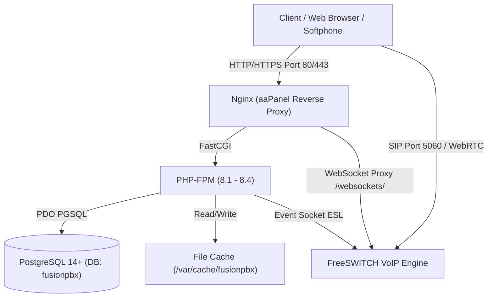

# Softcents Systems - WhiteInfo PBX Setup & Deployment Guide for aaPanel

## 1. Project Overview & Session Changelog

### 1.1 Project Information
* **Repository:** [https://github.com/softcents/whiteinfo-pbx1](https://github.com/softcents/whiteinfo-pbx1)
* **Default Branch:** `main`
* **Branding & Copyright:** Softcents Systems ([https://www.softcents.com](https://www.softcents.com))
* **Base Architecture:** FusionPBX 5.6 + FreeSWITCH + PostgreSQL + PHP-FPM + Nginx

### 1.2 Summary of Updates Performed
1. **Original Themes & Widgets Restored:**
   * Restored original FusionPBX dashboard ([core/dashboard/index.php](file:///var/www/fusionpbx/core/dashboard/index.php)).
   * Restored original widget implementations for `icon.php`, `active_calls.php`, `registrations.php`, and `system_status.php`.
   * Preserved previous custom "White Info" theme files in [themes/whiteinfo_backup/](file:///var/www/fusionpbx/themes/whiteinfo_backup/) for reference.
2. **Logos & Branding:**
   * Restored and preserved the custom company logos in [themes/default/images/](file:///var/www/fusionpbx/themes/default/images/):
     * `logo.png`, `logo_login.png`, `logo_header.png`
     * `logo_side_expanded.png`, `logo_side_contracted.png`
     * `favicon.ico`
3. **Copyright & Footer Updates:**
   * Configured copyright text across the system to:
     `&copy; Copyright 2026 <a href="https://www.softcents.com" class="footer" target="_blank">Softcents Systems</a>. All rights reserved.`
   * Updated [resources/footer.php](file:///var/www/fusionpbx/resources/footer.php) with fallback and unescaped HTML support for the footer.
   * Updated all authentication views (`login.htm`, `email.htm`, `passkey.htm`, `totp.htm`, `username.htm`).
   * Updated PostgreSQL default setting `v_default_settings` (`theme -> footer`).
4. **Git Repository Setup:**
   * Cleaned all custom sub-modules (`app/device_logs`, `app/language_model`, `app/speech`, `app/transcribe`, `billing_api.php`, `sso.php`, WHMCS modules).
   * Added SSH deploy key and pushed the complete codebase to `git@github.com:softcents/whiteinfo-pbx1.git` on branch `main`.

---

## 2. Architecture & Flow Diagram



---

## 3. Setting Up on aaPanel (Developer Step-by-Step Guide)

### Step 1: aaPanel Environment Requirements
Install the following software stack from aaPanel App Store:
1. **Nginx** (1.22+ or 1.24+)
2. **PHP** (PHP 8.1, 8.2, 8.3, or 8.4)
3. **PostgreSQL Manager / PostgreSQL** (v14 or newer)

---

### Step 2: Configure PHP in aaPanel

#### A. Install Required PHP Extensions
In aaPanel -> **App Store** -> Click on your installed PHP version -> **Extensions**:
Install the following extensions:
* `pgsql` / `pdo_pgsql`
* `sqlite3` / `pdo_sqlite`
* `fileinfo`
* `curl`
* `gd`
* `mbstring`
* `xml`
* `ldap` (if using LDAP directory auth)
* `opcache`
* `ioncube` (if running encoded billing/whmcs plugins)

#### B. Remove Disabled Functions
aaPanel disables several shell execution functions by default. FusionPBX requires shell execution for FreeSWITCH Event Socket, service controls, and audio processing.
1. Go to PHP Settings -> **Disabled functions**.
2. Remove the following functions from the disabled list:
   * `exec`
   * `shell_exec`
   * `system`
   * `passthru`
   * `proc_open`
   * `popen`
   * `putenv`

#### C. Adjust PHP Configuration Parameters
In PHP Settings -> **Configuration**:
* `upload_max_filesize = 80M`
* `post_max_size = 80M`
* `max_execution_time = 900`
* `max_input_time = 900`
* `memory_limit = 512M`

---

### Step 3: Clone Codebase to aaPanel Web Directory

Run in server terminal:
```bash
# Clone the repository
git clone https://github.com/softcents/whiteinfo-pbx1.git /www/wwwroot/whiteinfo-pbx1

# Set ownership to aaPanel web user (www:www)
chown -R www:www /www/wwwroot/whiteinfo-pbx1
chmod -R 755 /www/wwwroot/whiteinfo-pbx1

# Create runtime cache directory
mkdir -p /var/cache/fusionpbx
chown -R www:www /var/cache/fusionpbx
chmod -R 775 /var/cache/fusionpbx
```

---

### Step 4: Configure PostgreSQL Database

In aaPanel PostgreSQL Manager (or CLI):
```bash
# Create user and database
sudo -u postgres psql -c "CREATE USER fusionpbx WITH PASSWORD 'YourStrongPasswordHere';"
sudo -u postgres psql -c "CREATE DATABASE fusionpbx OWNER fusionpbx;"
sudo -u postgres psql -c "GRANT ALL PRIVILEGES ON DATABASE fusionpbx TO fusionpbx;"
```

---

### Step 5: Configure `/etc/fusionpbx/config.conf`

Create `/etc/fusionpbx/config.conf`:
```bash
sudo mkdir -p /etc/fusionpbx
sudo nano /etc/fusionpbx/config.conf
```

Paste the following configuration:
```ini
#database system settings
database.0.type = pgsql
database.0.host = 127.0.0.1
database.0.port = 5432
database.0.sslmode = prefer
database.0.name = fusionpbx
database.0.username = fusionpbx
database.0.password = YourStrongPasswordHere

#database switch settings
database.1.type = sqlite
database.1.path = /var/lib/freeswitch/db
database.1.name = core.db

#general settings
document.root = /www/wwwroot/whiteinfo-pbx1
project.path =
temp.dir = /tmp
php.dir = /usr/bin
php.bin = php

#security settings
security.header.content_security_policy.frame_ancestors =

#session settings
session.cookie_httponly = true
session.cookie_secure = true
session.cookie_samesite = Lax

#cache settings
cache.method = file
cache.location = /var/cache/fusionpbx
cache.settings = true

#switch settings
switch.conf.dir = /etc/freeswitch
switch.sounds.dir = /usr/share/freeswitch/sounds
switch.database.dir = /var/lib/freeswitch/db
switch.recordings.dir = /var/lib/freeswitch/recordings
switch.storage.dir = /var/lib/freeswitch/storage
switch.voicemail.dir = /var/lib/freeswitch/storage/voicemail
switch.scripts.dir = /usr/share/freeswitch/scripts

#switch xml handler
xml_handler.fs_path = false
xml_handler.reg_as_number_alias = false
xml_handler.number_as_presence_id = true

#error reporting options: user,dev,all
error.reporting = user
```

Ensure permissions:
```bash
sudo chmod 640 /etc/fusionpbx/config.conf
sudo chown -R www:www /etc/fusionpbx
```

---

### Step 6: Configure aaPanel Website & Nginx Vhost

1. In aaPanel -> **Website** -> **Add Site**:
   * **Domain:** `pbx.yourdomain.com`
   * **Root Directory:** `/www/wwwroot/whiteinfo-pbx1`
   * **PHP Version:** Select the PHP version configured in Step 2.
2. In Site Settings -> **Site directory**:
   * > [!IMPORTANT]
   * **Uncheck `open_basedir`** (FusionPBX needs access to `/etc/fusionpbx`, `/var/cache/fusionpbx`, and FreeSWITCH directories).
3. In Site Settings -> **Configuration (Nginx conf)**:
   Replace or merge the configuration with:

```nginx
server {
    listen 80;
    listen 443 ssl http2;
    server_name pbx.yourdomain.com;
    index index.php index.html;
    root /www/wwwroot/whiteinfo-pbx1;

    # SSL configuration (handled by aaPanel SSL tab or manually)
    # ssl_certificate ...;
    # ssl_certificate_key ...;

    client_max_body_size 80M;
    client_body_buffer_size 128k;

    # WebSockets reverse proxy (Event Socket / Audio / ESL)
    location /websockets/ {
        proxy_pass http://127.0.0.1:8080;
        proxy_http_version 1.1;
        proxy_set_header Upgrade $http_upgrade;
        proxy_set_header Connection "upgrade";
        proxy_set_header Host $host;
    }

    # REST API rewrite
    location ~* ^.*/api/.*$ {
        rewrite ^(.*)/api/(.*)$ $1/api/index.php?rewrite_uri=$2 break;
        fastcgi_pass unix:/tmp/php-cgi-82.sock; # Adjust according to installed aaPanel PHP socket
        fastcgi_index index.php;
        include fastcgi_params;
        fastcgi_param SCRIPT_FILENAME $document_root/app/api/index.php;
        fastcgi_param SCRIPT_NAME /app/api/index.php;
    }

    # Main routing
    location / {
        try_files $uri $uri/ /index.php?$query_string;
    }

    # PHP-FPM Handler
    location ~ \.php$ {
        fastcgi_pass unix:/tmp/php-cgi-82.sock; # Adjust PHP socket path
        fastcgi_index index.php;
        fastcgi_read_timeout 15m;
        include fastcgi_params;
        fastcgi_param SCRIPT_FILENAME $document_root$fastcgi_script_name;
    }

    # Allow long execution for upgrades
    location = /core/upgrade/index.php {
        fastcgi_pass unix:/tmp/php-cgi-82.sock;
        fastcgi_read_timeout 15m;
        include fastcgi_params;
        fastcgi_param SCRIPT_FILENAME $document_root$fastcgi_script_name;
    }

    # Security: Deny sensitive files
    location ~ /\. {
        deny all;
    }
    location ~ (\.git|\.htaccess|\.db|\.lua) {
        deny all;
    }
}
```

---

### Step 7: Database Migration & Schema Upgrade

Once PHP and PostgreSQL are connected, run the schema upgrade script from CLI:
```bash
sudo -u www php /www/wwwroot/whiteinfo-pbx1/core/upgrade/upgrade_schema.php
sudo -u www php /www/wwwroot/whiteinfo-pbx1/core/upgrade/upgrade_domains.php
```

Or log in to the web interface as `superadmin` and visit:
`https://pbx.yourdomain.com/core/upgrade/` -> Check **App Defaults**, **Menu Defaults**, **Permission Defaults**, and **Schema** -> Click **Upgrade**.

---

### Step 8: Verifying Themes & Softcents Systems Copyright

To ensure the copyright and branding display properly:
1. Log in to PBX GUI -> **Advanced** -> **Default Settings**.
2. Filter by Category: **Theme**.
3. Verify:
   * **Subcategory:** `footer`
   * **Value:** `&copy; Copyright 2026 <a href="https://www.softcents.com" class="footer" target="_blank">Softcents Systems</a>. All rights reserved.`
   * **Enabled:** `True`
4. Clear cache whenever settings change:
   ```bash
   rm -rf /var/cache/fusionpbx/*
   ```

---

## 4. Key Directory & File Map

| Path | Purpose |
|---|---|
| `/www/wwwroot/whiteinfo-pbx1` | Main PBX Document Root |
| `/etc/fusionpbx/config.conf` | Database and switch configuration file |
| `/var/cache/fusionpbx/` | Runtime cache directory (Must be writable by web server) |
| `themes/default/` | Active UI theme template (Original FusionPBX structure) |
| `themes/default/images/` | Custom company logos & favicon |
| `themes/whiteinfo_backup/` | Backup of custom White Info PBX cards and widgets |
| `resources/footer.php` | Global footer copyright rendering logic |
| `core/authentication/resources/views/` | Login and authentication templates |
| `billing_api.php` | Custom PBX billing API |
| `sso.php` | Single Sign-On handler |

---
*Documented for Softcents Systems (https://www.softcents.com)*
